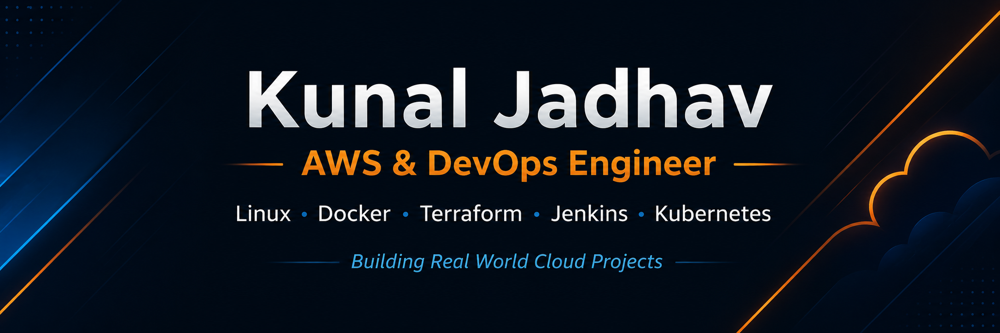
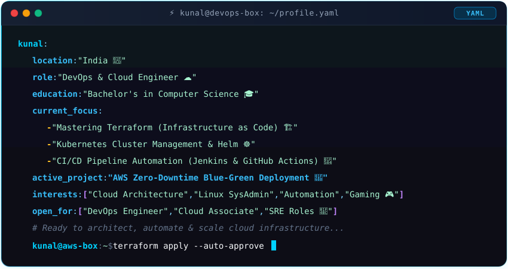

  

# ⚡ Kunal Jadhav ⚡
### ☁️ DevOps & Cloud Engineer | AWS | Linux | Docker | Terraform | Jenkins | Kubernetes

  

<!-- Social Badges -->

  
  
  

<!-- Status Badges -->

  
  

---

## 👨‍💻 About Me

  

<table width="100%">
  <tr>
    <td width="55%" valign="top">
      <h3>💡 What I Do &amp; Build</h3>
      

        I am a <b>DevOps &amp; Cloud Engineer</b> dedicated to designing resilient cloud architectures on AWS and automating zero-touch CI/CD pipelines.
      

      <ul>
        <li>☁️ <b>Cloud Infrastructure:</b> Designing resilient architectures on AWS (VPC, EC2, ECS, S3, IAM, Route 53).</li>
        <li>⚙️ <b>CI/CD Automation:</b> Building automated pipelines with Jenkins &amp; GitHub Actions.</li>
        <li>📦 <b>Containers &amp; IaC:</b> Containerizing workloads with Docker &amp; provisioning infrastructure with Terraform.</li>
        <li>🌱 <b>Kubernetes &amp; Observability:</b> Managing clusters with Kubernetes &amp; Helm, and monitoring with Prometheus &amp; Grafana.</li>
      </ul>
    </td>
    <td width="45%" valign="top">
      <h3>📌 Profile Snapshot</h3>
      
📍 <b>Location:</b> India

      
🎓 <b>Education:</b> Bachelor's in Computer Science

      
🚀 <b>Active Lab:</b> <a href="https://github.com/devkunaljadhav/Blue-Green-Deployment-of-Frontend-Web-Application-on-AWS">AWS Zero-Downtime Deployment</a>

      
💼 <b>Open For:</b> DevOps Engineer, Cloud Associate &amp; SRE Roles

      
🎮 <b>Interests:</b> Cloud Architecture, Linux SysAdmin, Automation, Gaming

      
💬 <b>Ask Me About:</b> AWS, Docker, Kubernetes, CI/CD, Terraform

    </td>
  </tr>
</table>

---

## 🛠️ Tech Stack & Skills

### ☁️ Cloud & Infrastructure

  

### ⚙️ DevOps, Containers & CI/CD

  

### 💻 Programming & Scripting

  

### 🗄️ Databases & Development Tools

  

---

## 🚀 Featured Projects

| Project | Description | Tech Stack | Repository |
| :--- | :--- | :--- | :---: |
| 🛡️ **[AWS Zero-Downtime Blue-Green Deployment](https://github.com/devkunaljadhav/Blue-Green-Deployment-of-Frontend-Web-Application-on-AWS)** | High-availability zero-downtime deployment strategy on AWS leveraging ALB, Route 53, Target Groups, and ACM SSL. | `AWS` `EC2` `ALB` `Route 53` `ACM` | [🔗 View Project](https://github.com/devkunaljadhav/Blue-Green-Deployment-of-Frontend-Web-Application-on-AWS) |
| ⚡ **[AWS Serverless Employee Management System](https://github.com/devkunaljadhav/AWS-Serverless-Employee-Management-System-with-Amazon-SQS)** | Decoupled event-driven serverless architecture using API Gateway, Lambda, Amazon SQS queuing, and DynamoDB for CRUD operations. | `AWS Lambda` `SQS` `DynamoDB` `API Gateway` `S3` | [🔗 View Project](https://github.com/devkunaljadhav/AWS-Serverless-Employee-Management-System-with-Amazon-SQS) |
| 🌐 **[AWS Full-Stack 3-Tier Web Application](https://github.com/devkunaljadhav/AWS-full-stack-web-application)** | Production-grade multi-tier architecture featuring React frontend, Node.js backend, EC2, RDS MySQL, ElastiCache Redis, and Nginx reverse proxy. | `AWS EC2` `RDS MySQL` `Redis` `Nginx` `React` `Node.js` | [🔗 View Project](https://github.com/devkunaljadhav/AWS-full-stack-web-application) |
| 🔄 **[AWS DMS Migration Showcase](https://github.com/devkunaljadhav/aws-dms-full-migration-lab)** | Homogeneous, heterogeneous & on-premises to Amazon RDS database migration lab using AWS DMS and CloudWatch monitoring. | `AWS DMS` `RDS` `MySQL` `CloudWatch` | [🔗 View Project](https://github.com/devkunaljadhav/aws-dms-full-migration-lab) |
| 🛠️ **[Bash DevOps Automation Toolkit](https://github.com/devkunaljadhav/bash-devops-toolkit)** | Practical Linux system administration & automation scripts for server monitoring, automated backups, and log rotation. | `Bash` `Linux` `Cron` `DevOps Automation` | [🔗 View Project](https://github.com/devkunaljadhav/bash-devops-toolkit) |

---

## 📊 GitHub Analytics & Activity

  
  

    

  

    

  

---

## 🤝 Connect & Collaborate

  
  
  

---

  *Built with passion, coffee ☕, and code by [Kunal Jadhav](https://github.com/devkunaljadhav).*

